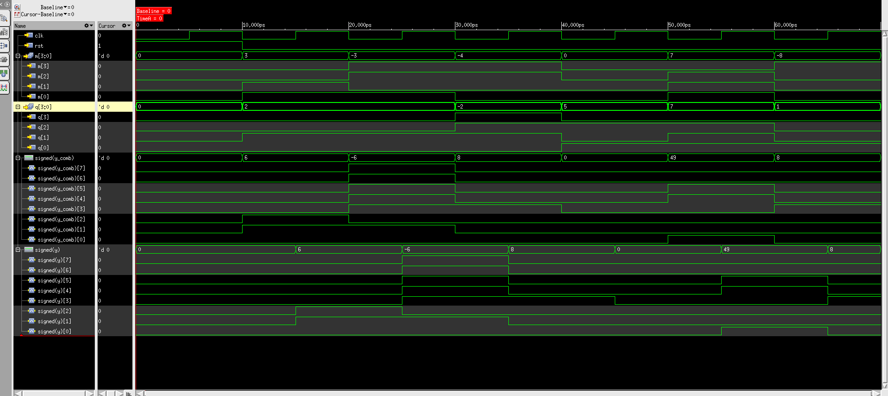
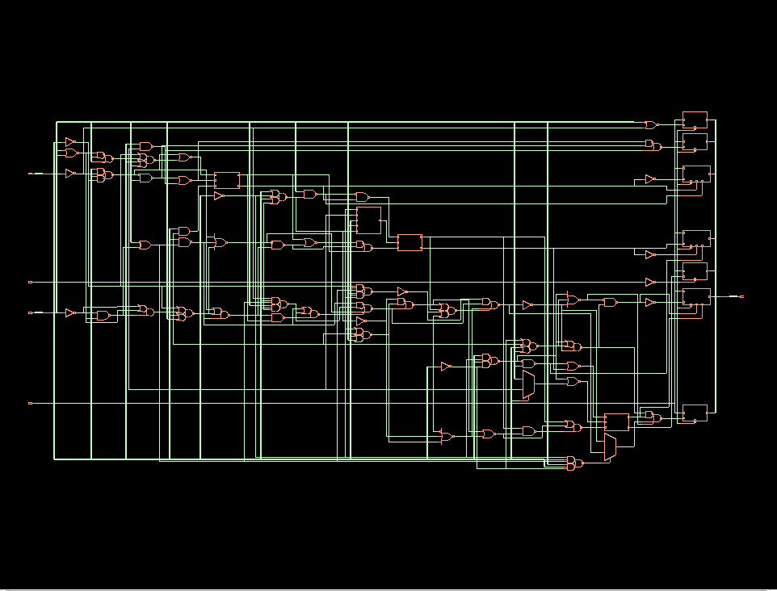

# ✖️ Booth's Multiplication Algorithm — RTL to Gate-Level Netlist


---

### Overview

This project implements **Booth's Radix-2 Multiplication Algorithm** in Verilog HDL for signed 4-bit operands, producing an 8-bit result. The design has been taken through the complete **RTL-to-synthesis flow** using Cadence Genus 21.14, targeting a **90 nm standard-cell library (slow corner)** and producing a verified gate-level netlist.

---

### Algorithm

Booth's algorithm reduces the number of addition/subtraction operations in signed binary multiplication using a **radix-2 recoding** scheme. It examines 2 bits at a time (current LSB + previous bit) to decide add, subtract, or shift.

```
Case {q[0], q_prev}:
  2'b01  →  Accumulate + M   (add multiplicand)
  2'b10  →  Accumulate − M   (subtract multiplicand)
  2'b00 / 2'b11  →  Arithmetic right shift only
```

---

### Port Description

| Port | Direction | Width | Description |
|------|-----------|-------|-------------|
| clk | Input | 1-bit | System clock |
| rst | Input | 1-bit | Active-high synchronous reset |
| m | Input | 4-bit signed | Multiplicand |
| q | Input | 4-bit signed | Multiplier |
| y | Output | 8-bit | Product (registered output) |

---

### Synthesis Flow

```
RTL Design  →  Elaboration  →  syn_gen  →  syn_map  →  syn_opt  →  Gate Netlist ✅
```

- **Tool:** Cadence Genus Synthesis Solution 21.14-s082_1
- **Technology:** 90 nm standard-cell library — slow corner
- **Operating Conditions:** slow (balanced_tree)
- **Constraints:** SDC with input/output delays

---

### File Structure

```
booth-multiplier-fpga/
├── booth_multiplication.v        ← RTL source — Booth's algorithm
├── booth_multiplication_tb.v     ← Testbench
├── booth_constraints.xdc         ← Timing constraints
├── synth_booth.tcl               ← Cadence Genus synthesis script
├── README.md
│
└── cadence_genus/
      ├── README.md               ← Full synthesis documentation
      ├── reports/
      │     ├── area.rpt          ← Area report
      │     ├── power.rpt         ← Power report
      │     ├── timing.rpt        ← Timing report
      │     └── cell_count.rpt    ← Cell count report
      ├── netlist/
      │     └── genus_gate_netlist.v  ← Synthesized gate-level netlist
      ├── screenshots/
      │     └── genus_gui.png     ← Genus GUI schematic
      └── waveforms/
            └── simulation_waveform.png ← Gate-level simulation waveform
```

---

### Testbench — Test Cases

| m (Multiplicand) | q (Multiplier) | Expected y |
|-----------------|----------------|------------|
| +3 | +2 | +6 |
| −3 | −2 | +6 |
| −4 | −2 | +8 |
|  0 | +5 |  0 |
| +7 | +7 | +49 |
| −8 | +1 | −8 |

---

### Simulation Waveform (Gate-Level)



> Gate-level simulation waveform showing clk, rst, m[3:0], q[3:0], signed(y_comb) and signed(y) — verified using Cadence SimVision after synthesis.

---

### ⏱ Timing Report (Cadence Genus)

| Parameter | Value | Status |
|-----------|-------|--------|
| Tool | Cadence Genus 21.14-s082_1 | — |
| Clock Period | 10.000 ns | — |
| Input Delay | 1.000 ns | — |
| Data-path Delay | 2.118 ns† | — |
| Setup Uncertainty | 0.200 ns | — |
| Required Time | 9.558 ns | — |
| Setup Slack (WNS) | +6.440 ns | ✅ MET |
| Startpoint | m[0] (input port) | — |
| Endpoint | y_reg[5]/SI | — |
| Operating Corner | slow (balanced_tree) | — |

> † 2.118 ns is the reported data-path delay from input port `m[0]` to `y_reg[5]/SI`. This is **not confirmed as the critical register-to-register delay**. The endpoint `y_reg[5]/SI` is a scan-chain input pin which may reflect scan-mode timing rather than functional-mode critical path.

---

### 📐 Area Report (Cadence Genus)

| Instance | Cell Count | Cell Area | Total Area |
|----------|-----------|-----------|------------|
| booth_multiplication | 72 | 488.957 | 488.957 |

> ⚠️ Area is reported in **library area units** — not verified as µm².

---

### ⚡ Power Report (Cadence Genus)

| Category | Total (W) | % |
|----------|-----------|---|
| Register | 2.185e-05 | 55.68% |
| Logic | 1.644e-05 | 41.89% |
| Clock | 9.558e-07 | 2.44% |
| **Total** | **3.925e-05** | **100%** |

- **Total Power: 39.2496 µW**
- Leakage: 5.66% — Internal: 77.86% — Switching: 16.48%

> ⚠️ Pre-layout power estimate — post-layout power may differ due to parasitic capacitances.

---

### 🔧 Cell Count Report (Cadence Genus)

**By Cell Type:**

| Type | Instances | Area | Area % |
|------|-----------|------|--------|
| Sequential | 7 | 156.678 | 32.0% |
| Inverter | 12 | 27.248 | 5.6% |
| Logic | 53 | 305.031 | 62.4% |
| **Total** | **72** | **488.957** | **100%** |

**Key Standard Cells Used:**

| Gate | Instances |
|------|-----------|
| NOR2XL | 7 |
| NAND2XL | 6 |
| OAI22X1 | 6 |
| CLKINVX1 | 8 |
| NAND2BX1 | 5 |
| DFFRHQX1 | 4 |
| ADDFX1 | 3 |
| SDFFRHQX1 | 3 |

---

### 🖥 Gate-Level Schematic (Cadence Genus)



> Post-synthesis gate-level schematic generated in Cadence Genus 21.14 showing mapped standard cells on 90 nm slow-corner library.

---

### Learning Outcome

- Implemented signed binary multiplication using Booth's radix-2 algorithm
- Completed RTL-to-synthesis flow using Cadence Genus 21.14
- Mapped design to 90 nm standard-cell library targeting slow corner
- Analyzed area, power, timing and cell count from Genus reports
- Verified gate-level netlist correctness through post-synthesis simulation

---

### Author

**Arshad Ansari**
M.Tech ECE (VLSI Design) — NIT Hamirpur
[](https://www.linkedin.com/in/arshadansari04/)
[](https://github.com/arshad-vlsi)
  
